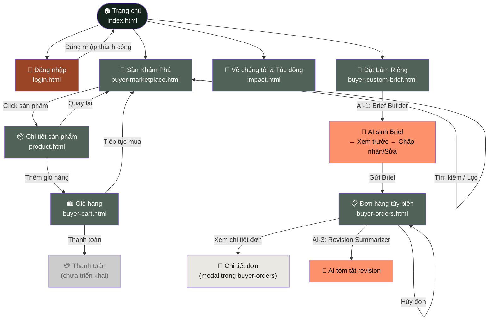
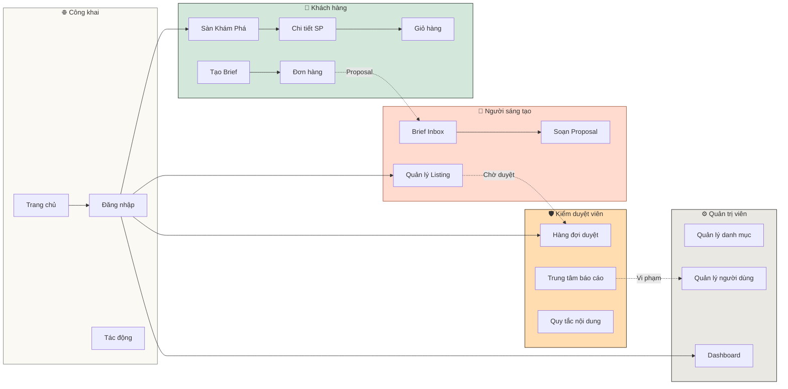

# Bảng Kiểm Kê Màn Hình – CraftLink

> **Dự án:** CraftLink – Sàn sản phẩm sáng tạo tùy biến  
> **Học phần:** Phát triển ứng dụng web cơ bản – CSE122  
> **Ngày cập nhật:** 25/10/2026  

---

## 1. Tổng quan các vai trò

| Vai trò | Số màn hình đã triển khai | Trạng thái |
|---|:---:|---|
| Dùng chung (Public) | 5 | ✅ Đã triển khai |
| Khách hàng (Buyer) | 4 | ✅ Đã triển khai |
| Người sáng tạo (Maker) | 3 | 🔲 Chưa triển khai |
| Kiểm duyệt viên (Moderator) | 3 | 🔲 Chưa triển khai |
| Quản trị viên (Admin) | 3 | 🔲 Chưa triển khai |

---

## 2. Bảng kiểm kê màn hình chi tiết

### 2.1. Màn hình dùng chung (Public / Shared)

| # | Tệp | Giao diện | CRUD / Trạng thái | AI | Mô tả chính | Trạng thái |
|:---:|---|---|---|:---:|---|:---:|
| S-01 | `index.html` | Trang chủ | R | — | Hero section, bộ sưu tập nổi bật, danh mục, chỉ số tác động xã hội, câu chuyện nghệ nhân, footer | ✅ |
| S-02 | `pages/login.html` | Đăng nhập / Đăng ký | R | — | Form đăng nhập với email/mật khẩu, chuyển tab đăng ký, đăng nhập Google/Facebook, quên mật khẩu | ✅ |
| S-03 | `pages/impact.html` | Về chúng tôi & Tác động | R | — | Sứ mệnh CraftLink, bản đồ nghệ nhân, chỉ số tác động, câu chuyện cộng đồng, timeline lịch sử | ✅ |
| S-04 | `pages/product.html` | Chi tiết sản phẩm | R | — | Gallery ảnh, thông tin sản phẩm, tab mô tả/đánh giá/câu chuyện, bộ đếm số lượng, thêm giỏ hàng | ✅ |
| S-05 | `pages/buyer-cart.html` | Giỏ hàng | R/U/D | — | Danh sách sản phẩm trong giỏ, tăng/giảm số lượng, xóa, tổng tiền, nút thanh toán | ✅ |

### 2.2. Khách hàng (Buyer)

| # | Tệp | Giao diện | Mục tiêu người dùng | Nhiệm vụ người dùng | CRUD / Trạng thái | AI | Người phụ trách | Trạng thái |
|:---:|---|---|---|---|---|:---:|---|:---:|
| B-01 | `pages/buyer-marketplace.html` | Sàn Khám Phá (Marketplace) | Tìm sản phẩm thủ công | Duyệt, tìm kiếm, lọc theo dân tộc / vùng miền / chất liệu / giá, sắp xếp | R | AI-2 (Style Matcher – gợi ý) | SV1 | ✅ |
| B-02 | `pages/buyer-custom-brief.html` | Tạo Yêu Cầu Tùy Biến (Brief) | Diễn đạt yêu cầu tùy biến | Điền form brief: tiêu đề, danh mục, số lượng, ngân sách, mô tả, deadline; xem trước; gửi brief | C/R/U | AI-1 (Brief Builder – chuyển mô tả → brief) | SV1 | ✅ |
| B-03 | `pages/buyer-orders.html` | Đơn Hàng Tùy Biến | Theo dõi đơn tùy biến | Xem danh sách đơn, lọc theo trạng thái (chờ, đang làm, hoàn thành, hủy), xem chi tiết, hủy đơn | C/R/U/D | AI-3 (Revision Summarizer) | SV1 | ✅ |
| B-04 | `pages/buyer-cart.html` | Giỏ Hàng | Quản lý giỏ hàng | Xem giỏ, thay đổi số lượng, xóa, tính tổng | R/U/D | — | SV1 | ✅ |

### 2.3. Người sáng tạo (Maker) – *Chưa triển khai*

| # | Tệp (dự kiến) | Giao diện | Mục tiêu người dùng | Nhiệm vụ người dùng | CRUD / Trạng thái | AI | Người phụ trách | Trạng thái |
|:---:|---|---|---|---|---|:---:|---|:---:|
| M-01 | `pages/maker-listing-management.html` | Quản lý Listing | Quản lý sản phẩm đăng bán | Xem danh sách listing, thêm/sửa/xóa listing, xem trạng thái duyệt | C/R/U/D | — | SV2 | 🔲 |
| M-02 | `pages/maker-brief-inbox.html` | Hộp Brief Nhận Được | Xem và phản hồi brief | Xem brief từ khách, lọc, chấp nhận/từ chối brief | R/U | AI-2 (Style Matcher) | SV2 | 🔲 |
| M-03 | `pages/maker-proposal-editor.html` | Soạn Proposal | Gửi đề xuất cho brief | Tạo/sửa/xóa proposal, đính kèm ảnh, gửi cho khách | C/R/U/D | AI-3 (Revision Summarizer) | SV2 | 🔲 |

### 2.4. Kiểm duyệt viên (Moderator) – *Chưa triển khai*

| # | Tệp (dự kiến) | Giao diện | Mục tiêu người dùng | Nhiệm vụ người dùng | CRUD / Trạng thái | AI | Người phụ trách | Trạng thái |
|:---:|---|---|---|---|---|:---:|---|:---:|
| D-01 | `pages/moderator-moderation-queue.html` | Hàng Đợi Kiểm Duyệt | Duyệt listing mới | Xem listing chờ duyệt, phê duyệt/từ chối, ghi lý do | R/U | — | SV3 | 🔲 |
| D-02 | `pages/moderator-report-center.html` | Trung Tâm Báo Cáo | Xử lý báo cáo vi phạm | Xem báo cáo, phân loại, xử lý (cảnh cáo/gỡ bài/khóa), lịch sử xử lý | C/R/U | — | SV3 | 🔲 |
| D-03 | `pages/moderator-content-guidelines.html` | Quy Tắc Nội Dung | Quản lý quy tắc cộng đồng | Xem/thêm/sửa/xóa quy tắc nội dung | C/R/U/D | — | SV3 | 🔲 |

### 2.5. Quản trị viên (Admin) – *Chưa triển khai*

| # | Tệp (dự kiến) | Giao diện | Mục tiêu người dùng | Nhiệm vụ người dùng | CRUD / Trạng thái | AI | Người phụ trách | Trạng thái |
|:---:|---|---|---|---|---|:---:|---|:---:|
| A-01 | `pages/admin-category-management.html` | Quản Lý Danh Mục | Quản lý taxonomy | Xem cây danh mục, thêm/sửa/xóa danh mục, sắp xếp thứ tự | C/R/U/D | — | SV3 | 🔲 |
| A-02 | `pages/admin-user-management.html` | Quản Lý Người Dùng | Quản lý tài khoản | Xem danh sách, tìm kiếm, lọc theo vai trò, khóa/mở khóa tài khoản | R/U | — | SV3 | 🔲 |
| A-03 | `pages/admin-platform-dashboard.html` | Bảng Điều Khiển Nền Tảng | Tổng quan nền tảng | Xem chỉ số KPI, biểu đồ doanh thu/đơn hàng, thống kê người dùng | R | — | SV3 | 🔲 |

---

## 3. Ma trận Tính năng AI

| Tính năng AI | Mô tả | Màn hình áp dụng | Cách mô phỏng | Trạng thái |
|---|---|---|---|:---:|
| **AI-1: Brief Builder** | Chuyển mô tả tự do thành creative brief có cấu trúc | B-02 (buyer-custom-brief) | JSON giả lập + JavaScript timeout mô phỏng xử lý | ✅ |
| **AI-2: Style Matcher** | Ghép brief/yêu cầu với maker/listing phù hợp | B-01 (buyer-marketplace) | Thuật toán lọc rule-based dựa trên dân tộc, vùng miền, chất liệu | ✅ |
| **AI-3: Revision Summarizer** | Tóm tắt các thay đổi revision cần làm | B-03 (buyer-orders) | Phản hồi định sẵn (canned responses) | ✅ |

---

## 4. Bao phủ trạng thái

| Trạng thái | index | login | marketplace | custom-brief | orders | product | cart |
|---|:---:|:---:|:---:|:---:|:---:|:---:|:---:|
| Bình thường | ✅ | ✅ | ✅ | ✅ | ✅ | ✅ | ✅ |
| Đang tải | — | — | ✅ | ✅ | — | — | — |
| Rỗng | — | — | ✅ | — | ✅ | — | ✅ |
| Thành công | — | ✅ | — | ✅ | — | ✅ | — |
| Lỗi (validation) | — | ✅ | — | ✅ | — | — | — |
| Vô hiệu hóa | — | — | — | ✅ | — | — | — |
| Đang chờ | — | — | — | — | ✅ | — | — |
| Hoàn thành | — | — | — | — | ✅ | — | — |
| Đã hủy | — | — | — | — | ✅ | — | — |

---

## 5. Sơ đồ User Flow

### 5.1. Luồng chính – Khách hàng (Buyer)



### 5.2. Luồng tổng quan – Tất cả vai trò (Dự kiến)



---

## 6. Cấu trúc tệp dự án hiện tại

```
Craftlink_website/
├── index.html                          ← S-01: Trang chủ
├── pages/
│   ├── login.html                      ← S-02: Đăng nhập
│   ├── buyer-marketplace.html          ← B-01: Sàn Khám Phá
│   ├── buyer-custom-brief.html         ← B-02: Tạo Brief
│   ├── buyer-orders.html               ← B-03: Đơn hàng
│   ├── buyer-cart.html                 ← B-04: Giỏ hàng
│   ├── product.html                    ← S-04: Chi tiết SP
│   └── impact.html                     ← S-03: Tác động
├── assets/
│   ├── css/
│   │   ├── colors.css                  ← Design tokens (màu)
│   │   └── base.css                    ← Typography base
│   └── js/
│       ├── data.js                     ← Mock data sản phẩm
│       ├── thocam.js                   ← Logic marketplace (filter, search, pagination, AI-2)
│       ├── product.js                  ← Logic chi tiết sản phẩm (tab, gallery, quantity)
│       └── tailwind-config.js          ← Cấu hình Tailwind CSS
└── docs/
    ├── assignment-craftlink.md         ← Đề bài BTL
    ├── design-system.md                ← Hệ thống thiết kế (design tokens)
    ├── screen-inventory.md             ← Bảng kiểm kê màn hình (tệp này)
    ├── ai-usage-report.md              ← Báo cáo sử dụng AI
    └── mockups/                        ← Ảnh mockup các trang
        ├── homepage.png
        ├── impact.png
        ├── product.png
        ├── screen.png
        └── thocam.png
```

---

## 7. Dữ liệu & API

| Nguồn dữ liệu | Mô tả | File / Endpoint |
|---|---|---|
| Mock Products (local) | 6 sản phẩm thổ cẩm với ảnh, giá, dân tộc, chất liệu | `assets/js/data.js` |
| Mock API (Postman) | API giả lập lấy danh sách sản phẩm | `https://81fed15e-...mock.pstmn.io/products` |
| LocalStorage | Lưu briefs đã tạo (`craftlink_briefs`) | Browser LocalStorage |

---

## 8. Checklist hoàn thành từng màn hình

### Ký hiệu: ✅ = Đã xong | 🔲 = Chưa làm | ⏳ = Đang làm

| Tiêu chí | S-01 | S-02 | S-03 | S-04 | S-05 | B-01 | B-02 | B-03 |
|---|:---:|:---:|:---:|:---:|:---:|:---:|:---:|:---:|
| HTML ngữ nghĩa | ✅ | ✅ | ✅ | ✅ | ✅ | ✅ | ✅ | ✅ |
| CSS hoàn chỉnh | ✅ | ✅ | ✅ | ✅ | ✅ | ✅ | ✅ | ✅ |
| Responsive | ✅ | ✅ | ✅ | ✅ | ✅ | ✅ | ✅ | ✅ |
| Tương tác JavaScript | ✅ | ✅ | ✅ | ✅ | ✅ | ✅ | ✅ | ✅ |
| Validation (nếu có form) | — | ✅ | — | — | — | — | ✅ | — |
| Dữ liệu giả lập | ✅ | — | ✅ | ✅ | ✅ | ✅ | ✅ | ✅ |
| Trạng thái rỗng | — | — | — | — | ✅ | ✅ | — | ✅ |
| Trạng thái loading | — | — | — | — | — | ✅ | ✅ | — |
